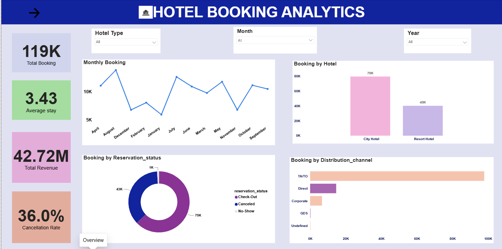
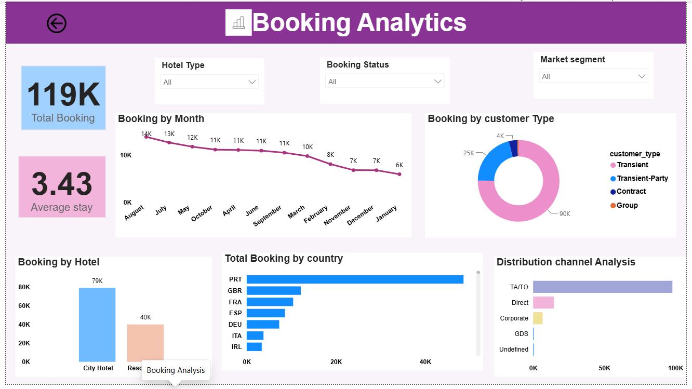
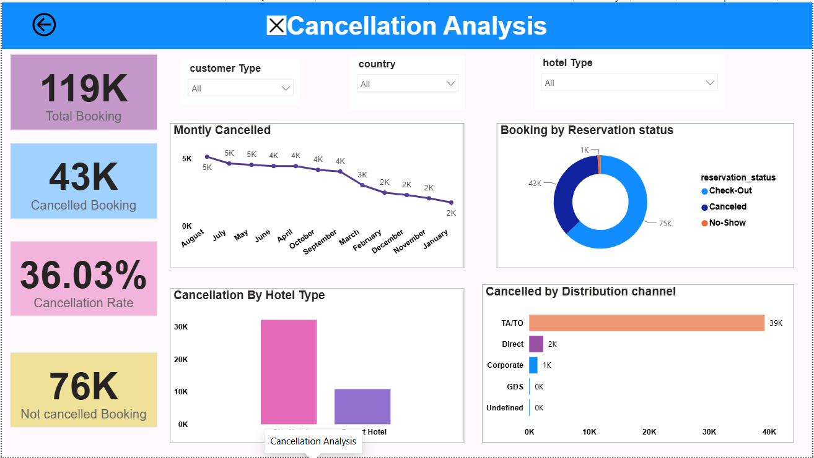
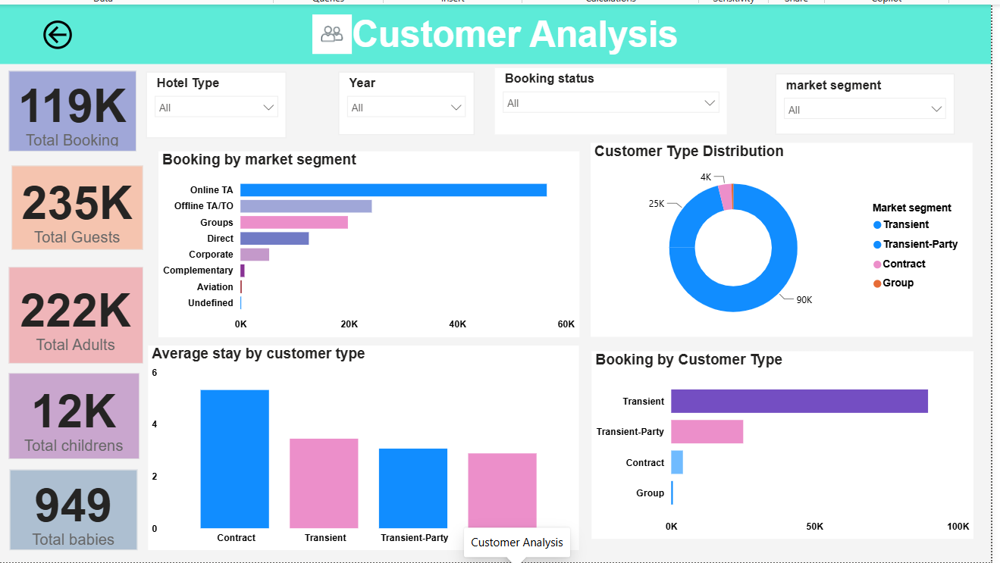

 🏨 Hotel Booking Analytics Dashboard

 📌 Project Overview

This project analyzes hotel booking data to understand customer behavior, booking patterns, cancellations, and overall hotel performance.

The interactive dashboard was created using **Power BI** to transform raw hotel booking data into meaningful business insights.

 🎯 Project Objectives

- Analyze overall hotel bookings
- Understand customer booking behavior
- Analyze booking cancellations
- Identify customer demographics and patterns
- Compare different hotel booking trends
- Provide useful insights for better business decisions

 🛠️ Tools Used

- **Power BI** – Data visualization and dashboard creation
- **Power Query** – Data cleaning and transformation
- **DAX** – Creating measures and calculations

 📊 Dashboard Pages

### 🏨 Overview Dashboard

Provides an overall summary of hotel booking performance using important KPIs and visualizations.

### 📅 Booking Analysis

Analyzes booking patterns and helps understand hotel reservation trends.

### ❌ Cancellation Analysis

Analyzes cancelled bookings and identifies cancellation patterns.

---

### 👥 Customer Analysis

Provides insights into customer behavior and customer-related booking trends.

---

## 📁 Project Files

- 📊 **Hotel booking Analytics.pbix** – Power BI Dashboard
- 📄 **hotel_booking_dataset.csv** – Dataset used for analysis
- 🖼️ **Overview.png** – Overview dashboard screenshot
- 🖼️ **Booking.png** – Booking analysis screenshot
- 🖼️ **Cancellation.png** – Cancellation analysis screenshot
- 🖼️ **Customer.png** – Customer analysis screenshot

---

## 📈 Key Insights

The dashboard helps analyze:

- Total hotel guests
- Adults and children
- Average guests per booking
- Repeat guests
- Booking trends
- Cancellation patterns
- Customer behavior

---

## 🚀 Conclusion

This project demonstrates how **Power BI** can be used to clean, analyze, and visualize hotel booking data. The dashboard converts raw data into meaningful insights that can help businesses understand customer behavior and improve decision-making.

