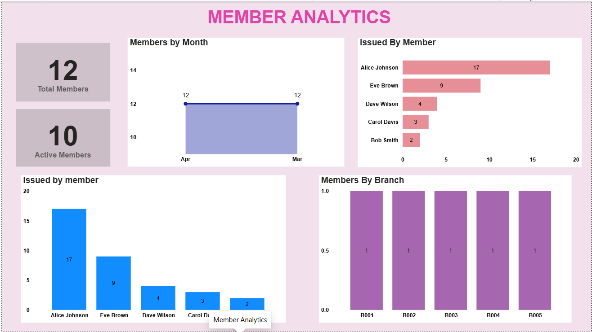

# 📚 Library Management Analytics Dashboard

## 📌 Project Overview

This project focuses on analyzing library operations using Power BI. The dashboard provides insights into book analytics, branch and employee performance, member activities, book issue and return patterns, and overdue fine analysis.

The project uses multiple datasets to transform library data into meaningful insights through interactive dashboards and visualizations.

## 🎯 Project Objectives

- Analyze overall library performance.
- Understand book availability and book-related trends.
- Analyze branch and employee performance.
- Monitor member activities.
- Analyze book issue and return patterns.
- Identify overdue books and fine-related information.
- Support better library management decisions.

## 📊 Dataset

The project uses the following datasets:

- **books.csv** – Book-related information.
- **branch.csv** – Library branch details.
- **employees.csv** – Employee information.
- **members.csv** – Library member details.
- **issued_status.csv** – Book issue records.
- **return_status.csv** – Book return records.

## 🛠️ Tools Used

- **Power BI** – Dashboard creation and data visualization.
- **Power Query** – Data cleaning and transformation.
- **DAX** – Calculations and measures.
- **CSV Files** – Data sources.

## 📊 Dashboard Analysis

### 1. Executive Dashboard

Provides an overall view of library performance through key metrics and visualizations.


### 2. Books Analytics

Focuses on book-related information and helps analyze book availability and library book trends.


### 3. Branch & Employee Analytics

Analyzes library branches and employee-related performance to understand operational activities.


### 4. Issue & Return Analysis

Analyzes book issuing and returning activities to understand library transaction patterns.


### 5. Members Analytics

Provides insights into library members and their activities.



### 6. Overdue Fine Analysis

Focuses on overdue books and fine-related information to understand overdue patterns.


## 🧠 Key Skills Demonstrated

- Data Cleaning
- Data Transformation
- Data Modeling
- DAX Calculations
- Interactive Dashboard Development
- Data Visualization
- Business Insights

## 📁 Project Structure

```text
Library-Management/
│
├── README.md
│
├── books.csv
├── branch.csv
├── employees.csv
├── members.csv
├── issued_status.csv
├── return_status.csv
│
├── Executive dashboard.png
├── Books analytics.png
├── Branch & employee analytics.png
├── issue & return.png
├── members.png
└── overdue fine analysis.png
```

## 🚀 Conclusion

This project demonstrates how Power BI can be used to analyze library operations and present meaningful insights through interactive dashboards. It helps understand book analytics, member activities, branch performance, issue and return patterns, and overdue fine analysis.

##

