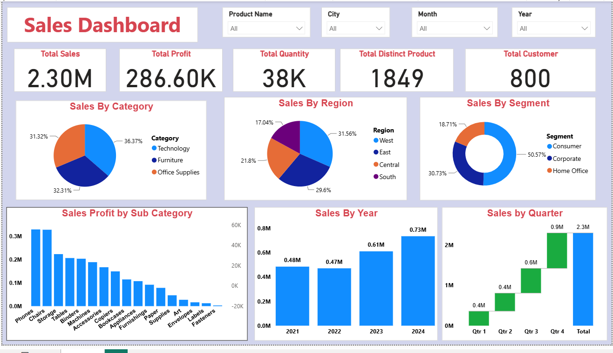

 📊 Sales Analysis Dashboard | Power BI

📌 Project Overview
This project focuses on analyzing sales data using Power BI to identify sales trends, monitor business performance, and support data-driven decision-making.

The interactive dashboard provides insights into sales, profit, quantity sold, and customer activity.

 🎯 Project Objectives
- Analyze overall sales performance.
- Identify sales and profit trends.
- Understand sales performance across different cities.
- Monitor important business KPIs.
- Support business decisions through data visualization.

 🛠️ Tools and Technologies
- **Power BI:** Dashboard creation and visualization
- **DAX:** Calculating key business metrics
- **Power Query:** Data cleaning and transformation

 📊 Key Performance Indicators (KPIs)
1. Total Sales
2. Total Profit
3. Total Quantity
4. Total Customers

 📈 Dashboard Visualizations
- **KPI Cards:** Display important sales metrics.
- **Stacked Bar Chart:** Compare sales across categories.
- **Waterfall Chart:** Visualize changes in business performance.
- **Line Chart:** Analyze sales trends over time.
- **City Slicer:** Filter dashboard information by city.

 📂 Project Files
- `Sales_Data.csv` — Sales dataset
- `Sales Dashboard.pbix` — Interactive Power BI dashboard
- `README.md` — Project documentation

 💡 Business Insights
The dashboard enables users to:
- Compare sales performance.
- Monitor profit and sales trends.
- Explore city-wise sales performance.
- Identify opportunities for business improvement.

 ✅ Conclusion
This project demonstrates how Power BI can transform raw sales data into meaningful visual insights to support business analysis and decision-making.

## Dashboard Screenshot

